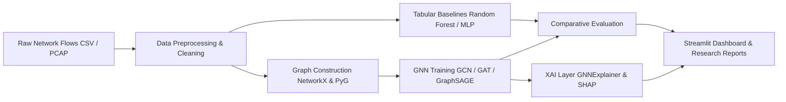

# X-IDS: Explainable AI-driven Network Intrusion Detection System using Graph Neural Networks

[](https://www.python.org/)
[](https://pytorch.org/)
[](https://pyg.org/)
[](https://streamlit.io/)
[](LICENSE)

---

## 📌 Project Overview

**X-IDS** is a research-grade **Explainable AI-driven Network Intrusion Detection System** that models computer network traffic as dynamic communication graphs and leverages **Graph Neural Networks (GNNs)** alongside post-hoc **Explainable AI (XAI)** frameworks. 

Traditional Network Intrusion Detection Systems (NIDS) analyze network flows as independent, isolated records using conventional tabular machine learning algorithms. However, modern cyber attacks (such as Advanced Persistent Threats, distributed denial-of-service, botnet command-and-control propagation, and lateral movement) inherently exhibit complex topological dependencies across multiple communicating endpoints. **X-IDS** models IP entities as nodes and transmission flows as relational edges, capturing topological context with GNNs (GCN, GAT, GraphSAGE) and providing transparent, interpretable rationales for security operators via graph explainability methods.

---

## ⚠️ Problem Statement

Modern enterprise and cloud networks face sophisticated, distributed cyber-attacks that evade traditional signature-based and isolated flow-based anomaly detectors:

1. **Loss of Relational Context:** Classical tabular ML models (Random Forest, SVM, MLP) treat network flows independently, ignoring topological interactions, multi-hop communication patterns, and network graph structures.
2. **High False Alarm Rates:** In high-throughput network environments, minute false positive rates flood security operation center (SOC) analysts with thousands of unvalidated alerts.
3. **Black-Box Opacity:** Deep learning models lack transparency, making it difficult for cybersecurity operators to understand *why* a particular flow or host was classified as malicious, hindering incident response and root-cause analysis.

---

## 🎯 Project Objectives

- **Relational Graph Modeling:** Transform tabular network flow logs (e.g., CIC-IDS2017, CSE-CIC-IDS2018, UNSW-NB15) into expressive graph structures where nodes represent endpoints and edges represent communication flows.
- **Advanced GNN Architecture Development:** Implement, train, and benchmark Graph Neural Networks (Graph Convolutional Networks, Graph Attention Networks, and GraphSAGE) for node and edge/flow classification.
- **Empirical Baseline Benchmarking:** Compare GNN detection efficacy against traditional machine learning baselines (Random Forest, XGBoost, Tabular MLP) across precision, recall, F1-score, and false positive rates.
- **Explainable AI (XAI) Integration:** Provide interpretable decision explanations using GNNExplainer, SubgraphX, and SHAP to highlight critical attack paths, influential neighboring nodes, and dominant flow features.
- **Interactive SOC Dashboard:** Deliver a real-time Streamlit web dashboard for network flow inspection, graph visualization, anomaly detection benchmarking, and explainability exploration.

---

## 🛠️ Planned Technology Stack

| Layer | Technologies |
|---|---|
| **Core & Data Processing** | Python 3.10+, NumPy, Pandas |
| **Graph Modeling & Analysis** | NetworkX, PyTorch Geometric (PyG) |
| **Deep Learning & ML** | PyTorch, Scikit-Learn |
| **Explainable AI (XAI)** | GNNExplainer, SubgraphX, SHAP |
| **Data & Graph Visualization** | Matplotlib, Seaborn, PyVis / NetworkX |
| **Interactive Dashboard** | Streamlit |
| **Experimentation** | Jupyter Notebooks |

---

## 📂 Repository Structure

```
X-IDS/
│
├── dataset/
│   └── README.md                   # Dataset documentation, schemas, and storage setup
│
├── notebooks/                      # Sequential research and experimentation notebooks
│   ├── 01_data_analysis.ipynb      # Exploratory Data Analysis (EDA) on network flows
│   ├── 02_preprocessing.ipynb      # Data cleaning, scaling, and feature engineering
│   ├── 03_baseline_models.ipynb    # Tabular ML baseline benchmarks (RF, MLP, XGB)
│   ├── 04_graph_construction.ipynb # Graph topology creation and PyG Data formatting
│   ├── 05_gnn_models.ipynb         # GNN architecture implementation & training (GCN, GAT)
│   └── 06_explainability.ipynb     # XAI workflows (GNNExplainer, SHAP)
│
├── src/                            # Modular production-ready Python source package
│   ├── __init__.py                 # Package initialization
│   ├── preprocessing.py            # Data loading, cleaning, encoding, and scaling pipelines
│   ├── graph_builder.py            # NetworkX & PyG graph construction from flow records
│   ├── models.py                   # PyTorch/PyG neural network model architectures
│   ├── train.py                    # Training loops, validation, early stopping, checkpointing
│   └── evaluate.py                 # Evaluation metrics (Accuracy, F1, ROC-AUC, FPR) & plots
│
├── results/
│   └── README.md                   # Documentation for artifacts, metrics, and figures
│
├── dashboard/
│   └── app.py                      # Interactive Streamlit SOC monitoring dashboard
│
├── requirements.txt                # Core Python package dependencies
└── README.md                       # Main project documentation
```

---

## 🚀 Installation & Setup

### 1. Clone the Repository
```bash
git clone https://github.com/your-username/X-IDS.git
cd X-IDS
```

### 2. Set Up a Virtual Environment
```bash
# Using venv
python -m venv venv

# Activate on Windows:
venv\Scripts\activate

# Activate on Linux / macOS:
source venv/bin/activate
```

### 3. Install Dependencies
```bash
pip install -r requirements.txt
```

> **Note on PyTorch & PyTorch Geometric:** For GPU acceleration (CUDA), follow the official installation instructions for your CUDA version from [pytorch.org](https://pytorch.org/) and [pyg.org](https://pyg.org/).

### 4. Run the Streamlit Dashboard
```bash
streamlit run dashboard/app.py
```

---

## 🔄 Project Workflow



1. **Data Ingestion & Preprocessing:** Load raw benchmark network flows, clean missing/infinite values, encode categorical variables, and normalize numerical features.
2. **Graph Construction:** Map IP endpoints into graph vertices and communication records into directed feature-weighted edges.
3. **Model Training:** Train both tabular baseline classifiers and graph neural network models with reproducible random seeding.
4. **Evaluation & Benchmarking:** Generate confusion matrices, ROC/PR curves, and calculate F1-score and false alarm rates.
5. **Interpretability & Attribution:** Extract explanation subgraphs and feature attributions to pinpoint malicious indicators.
6. **Dashboard Visualization:** Monitor detection results, visualize communication graphs, and inspect XAI explanations in the Streamlit interface.

---

## 👥 Team & Contribution Guidelines

We welcome research contributions, bug fixes, and feature additions!

### Contribution Process
1. **Fork the Project** & create your feature branch:
   ```bash
   git checkout -b feature/your-feature-name
   ```
2. **Commit your Changes** following standard conventional commits:
   ```bash
   git commit -m "feat: implement GAT attention visualization"
   ```
3. **Push to the Branch**:
   ```bash
   git push origin feature/your-feature-name
   ```
4. **Open a Pull Request** describing your additions, experimental setup, and any observed metric improvements.

---

## 📄 License

This research project is licensed under the MIT License - see the `LICENSE` file for details.
